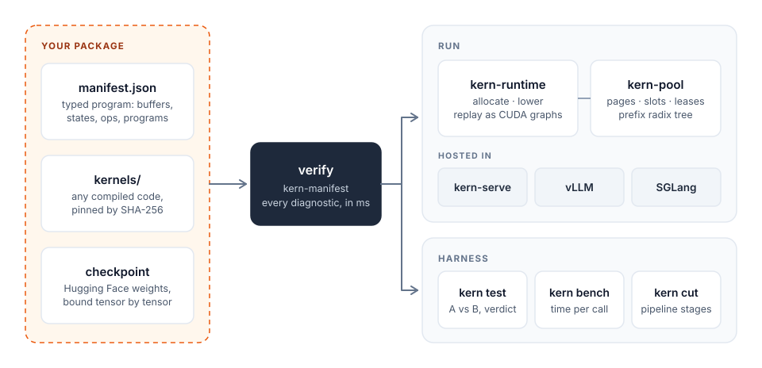
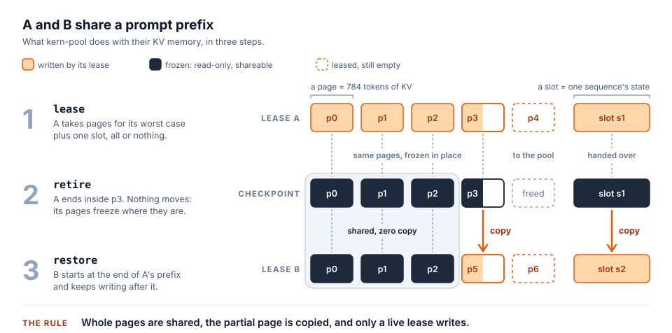
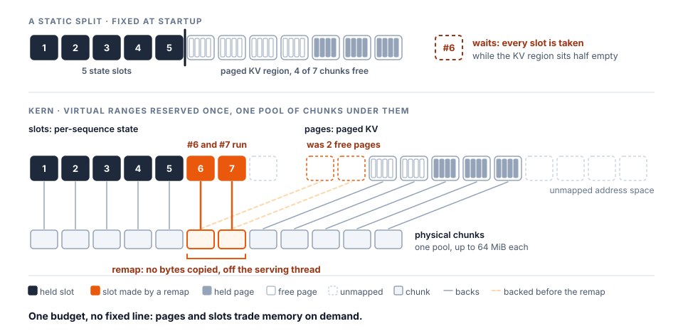

<p align="center">
  
</p>

<h1 align="center">Built by agents. Built for agents.</h1>

<h3 align="center">
  kern lets agents change the whole inference stack, fast and safely,<br>
  so every model, every workload and every GPU gets a high-performance engine of its own.
</h3>

<p align="center">
  <a href="https://kern-baa.pages.dev/">Website</a> ·
  <a href="https://kern-baa.pages.dev/docs/getting-started/">Quick start</a> ·
  <a href="docs/README.md">Docs</a>
</p>

---

## What agents have done with it

- [**One night, 17% more requests than vLLM.**](docs/vllm-rsi-example.md) Agents optimized Qwen3.8-27B on live Claude Code traffic, three rounds, no human in between.
- [**The same engine in SGLang, 10.5% more requests.**](docs/sglang.md) The overnight manifest, rewritten for SGLang's memory layout.
- [**A new model family in one session.**](docs/qwen38-bringup.md) Qwen3.8-27B plus its speculative draft in under 2.5 hours, one human intervention.
- [**A kernel set from six agents in parallel.**](docs/k3-kernel-abi.md) K3 decode kernels against a written ABI, step time 37.2 → 29.3 ms.
- [**An engine per GPU.**](docs/registry.md) DeepSeek-V4.1-Flash ships separate manifests for GB300 and HGX B300.
- [**Full-size models across GPUs and trays.**](docs/serve.md) DeepSeek-V4.1-Flash at EP4, full-size K3 prefill across eight pipeline stages.

## Own your stack.

Today's engines are million-line programs that carry, in one codebase:

```
models × precisions × GPUs × parallelism × decoding tricks × workloads
```

The two biggest open engines: 1.4M and 2.0M lines, 280 and 247 model files.

Say you only want K3 to be fast on an NVL72. In a shared engine that is a
change to code that also serves every other model on every other GPU, and
there are three ways to make it:

- **Upstream.** Your PR joins 10,000 others open in those two. Four in five
  have no human review.
- **Fork.** Skip rebases and miss every new model and kernel. Take them and
  fight conflicts; even a clean one ships thousands of PRs never run on your
  GPUs.
- **Hand it to an agent.** Which kernel runs? If the arch is this, and the
  head count is that, and the dtype is something else, unless parallelism is
  on, or a flag says otherwise. Good luck.

kern splits engine from model. The engine contains no model and rarely
changes. The model, parallelism included, ships as three things:

```
manifest.json     one typed declaration: buffers, states, ops, programs, parallelism
kernels/          compiled device code, from anywhere
weights           the model's own Hugging Face checkpoint
```

**A model is not code to merge. It is a package you own.**

Your K3-on-NVL72 engine is your repo, like
[kern-k3-pp-prefill](https://github.com/pegainfer-project/kern-k3-pp-prefill).
No review queue, no rebase, no "it depends." For an agent, that repo is the
whole world.

## Architecture



### The manifest

Everything an engine would need to know about a model is written down in the
manifest, so the runtime does not have to know it. A program is a list of
calls. Each call binds an op to buffers and vars, and each op is a typed
signature plus the launches that implement it:

```json
"ops": {
  "embedding": {
    "params": ["in buffer<i64>", "in buffer<bf16>", "out buffer<bf16>", "i32"],
    "impl": { "launches": [{ "module": "embedding", "entry": "kern_embedding_i64_bf16",
                             "grid": ["rows", 1, 1], "block": [256, 1, 1], … }] } } },
"programs": {
  "decode": { "graph": true, "calls": [
    { "op": "embedding", "args": [{"buf": "token_ids"}, {"buf": "embed"}, {"buf": "hidden"}, {"var": "rows"}] },
    … ] } }
```

A module is any compiled device code: vendored from FlashInfer or TRT-LLM,
written by hand, or written by an agent. It is pinned by SHA-256 and fetched
from a path, a URL or the Hugging Face hub. Swapping a kernel means editing
one launch.

**Memory** comes in two kinds, and K3 shows both:

```json
"buffers": {
  "token_ids": { "dtype": "i64",  "shape": ["rows"],       "kind": "input" },
  "embed":     { "dtype": "bf16", "shape": [163840, 7168], "kind": "weight",
                 "bind": [{ "tensor": "language_model.model.embed_tokens.weight" }] },
  "stats":     { "dtype": "i32",  "shape": [224],          "kind": "workspace" }
},
"states": {
  "kv":  { "bytes_per_token": 1152 },
  "kda": { "bytes_per_seq": 19537920 }
}
```

A buffer is a tensor whose kind says where it comes from: the caller
supplies an `input`, a `weight` binds by name to a tensor in the
Hugging Face checkpoint, and `workspace` is scratch that lasts one call.
A state is memory that outlives a step, declared only by its size. K3's MLA
cache takes 1,152 bytes per token and its KDA linear-attention state takes
19.5 MB per sequence. The runtime pages the first and hands out slots of the
second, both from one pool, and never learns that one is attention and the
other a recurrence.

**Shapes** come from vars. `rows` in the shapes and launch grids above is
one, along with sequences and context length, and each has a bound. Every
buffer size and launch grid is checked at those bounds, and a call outside
them is rejected before it launches.

**Parallelism and serving** are declared too. Topology names rank groups,
and a `peer` buffer holds the other ranks' addresses, so an all-reduce or an
all-to-all is a kernel in the manifest. A new parallel layout is a new
manifest, not a runtime change. The serving protocol says which buffers carry
tokens, slots and sequence lengths, and which programs run per batch. Hosts
read those roles and never a model's name.

Because all of this is data, `verify` checks the whole manifest at once in
milliseconds and reports every problem, not just the first. That is the loop
an agent iterates against.

### The runtime

`kern-runtime` loads a verified manifest, allocates, binds weights, lowers
each program to a flat launch list and replays it, captured as a CUDA graph
per shape bucket where it can. The binary links no CUDA library; it dlopens
the driver and cuBLAS on first use. Nothing in it branches on a model.

`kern-pool` makes every decision about state memory as pure host code and
returns it as a plan the runtime executes, so the bookkeeping is tested
without a GPU. It does two things.



**It shares prefixes by page.** A request leases the pages its worst case
needs and a state slot, all or nothing. When it ends, its pages freeze in
place as a checkpoint. A later request with the same prefix shares the
whole pages and gets a copy of only the page the prefix ends inside, so
every page has at most one writer. A token radix tree finds the longest
checkpoint for a prompt; under pressure, checkpoints park in host memory and
wake straight into a new lease.



**It keeps one budget for all state.** Every state reserves a virtual
address range once, and one pool of physical chunks backs them all through
CUDA VMM. Leasing and freeing touch only free lists, and a freed page stays
a page. Only when slots run short while pages sit free, or the reverse, does
the pool remap: the free pages' chunks are unmapped and mapped under the
slot range. Kernels still see one contiguous array per state, so nothing is
copied, no kernel changes, memory never fragments, and the same chunks can
be exported to ranks on other trays. The manifest's `seqs` bound sizes one
step's batch; how many sequences hold state is up to the budget, not a
number fixed at startup.

### The harness

`kern test` takes a reference manifest A and a candidate B. It diffs them
call by call, then records A on a seeded workload, keeping each span's
inputs and the bytes it wrote. B replays span by span from A's own inputs,
so each comparison covers exactly one span's write set, against a noise
floor measured by replaying A against itself. End to end it compares logits
by per-row KL and tells near-ties from real flips by the top-1/top-2 margin.
The verdict is one line and an exit code: 0 pass, 1 fail, 2 inconclusive.

`kern bench` takes a workload of shapes (sequences × rows × context) and
attributes time to every call inside the real program; `--isolate` measures
a single call on its own, cold and warm. A server's traced steps become a
workload directly, so a change is priced in GPU seconds on the traffic
actually served. `kern cut` slices a manifest into pipeline stages by
liveness, each stage a manifest whose inputs are the previous stage's
outputs.

Everything is deterministic: no clocks, no randomness, no dependence on
iteration order. The same manifest and inputs give the same bytes, so
running twice and diffing is a test.

### Hosts

`kern-serve` is kern's own server: continuous batching, an OpenAI-compatible
API, a prefix cache, sessions that sleep to host memory, and EP, TP and
pipeline stages across trays. kern also runs as the model inside vLLM or
SGLang: the host allocates the KV and state pools, kern checks their layout
against the manifest's `host` states, and launches enqueue on the host's
stream, inside its CUDA graphs. Scheduling, caching and sampling stay with
the host; the forward pass is the manifest.

Details: [manifest](docs/manifest.md) · [runtime](docs/runtime.md) ·
[pool](docs/pool.md) · [test](docs/test.md) · [bench](docs/bench.md) ·
[serve](docs/serve.md) · [vLLM](docs/vllm.md) · [SGLang](docs/sglang.md)

## Agents change the whole stack

Everything that makes an engine fast lives in the manifest, so it is all
fair game: which kernel runs each op, where the fusion boundaries are, how a
step maps to launches, how the model splits across GPUs, how speculative
decoding composes its rounds.

**Fast.** A changed manifest is type-checked in milliseconds. `kern test`
replays it against a reference span by span and returns a verdict in
seconds. `kern bench` says where the time goes on the shapes your service
actually sees, not on one representative batch.

**Safe.** Zero trust: every kernel is pinned by SHA-256, every buffer it
touches is declared, and nothing ships without a verdict against the
reference. The engine stays the same, so a change can only break the
manifest it lives in.

One line of a manifest can point at a kernel package on the Hugging Face hub:

```diff
  "silu_mul": { "params": ["out buffer<bf16>", "in buffer<bf16>"],
    "impl": { "launches": [{
-     "entry": "_ZN4vllm18act_and_mul_kernel…packed_silu_kernel…",
+     "module": "activation",
+     "entry": "_ZN4vllm18act_and_mul_kernel…",
  "modules": {
+   "activation": { "source": "hf:kernels-community/activation/…/_activation_320b408.abi3.so",
+                   "sha256": "73748b54…b1fe49aa" }
```

A runtime with no torch and no Python fetched it, verified it, ran it.
Output: byte-identical.

## Try it

```bash
curl -fsSL https://kern-baa.pages.dev/install.sh | sh   # Linux x86_64 / aarch64, one binary
kern --version                                          # kern 0.2.3 (<commit>, cuda 13.0)
```

The [quick start](https://kern-baa.pages.dev/docs/getting-started/) runs
Qwen3.8-27B from the published kernels and the checkpoint you already have,
plain and with its DFlash2 draft, in four commands. The binary links no CUDA
library; it needs an NVIDIA driver for CUDA 13 (r580+) and cuBLAS 13 on the
loader path. `KERN_VERSION` pins a release, `KERN_INSTALL_DIR` picks the
directory (default `~/.local/bin`).

From source, with the fixture targets in `kern.toml`:

```bash
cargo build --release
./target/release/kern run qwen3-4b --steps 320                  # generate
./target/release/kern test qwen3-4b                             # verdict for a change: exit 0 PASS / 1 FAIL / 2 INCONCLUSIVE
./target/release/kern bench qwen3-4b --workload tools/profiles/quick.toml --out quick.json
./target/release/kern server qwen3-4b --port 8000               # OpenAI-compatible server
```

Inside vLLM, the manifest is the model and vLLM keeps everything else:

```bash
pip install kern-llm
hf download Pegainfer/kern-qwen38-sm103 --local-dir kern-qwen38
KERN_MANIFEST=kern-qwen38/manifests/qwen3.8-27b-vllm.json KERN_KERNELS=kern-qwen38/cubins \
vllm serve Qwen/Qwen3.8-27B --hf-overrides '{"architectures": ["KernForCausalLM"]}'
```

SGLang works the same way through `kern_sglang`, in the same package: [docs/sglang.md](docs/sglang.md).
`kern <cmd> --help` lists the flags; `crates/kern-run/src/config.rs`
documents `kern.toml`.

## Deployments

A model's deployment lives in a repository of its own: the generator, the
kernel sources and builds it pins, and the manifests. kern stays model-agnostic.

| Repository | Model | How it is served |
| --- | --- | --- |
| [pegainfer-project/kern-k3-pp-prefill](https://github.com/pegainfer-project/kern-k3-pp-prefill) | Kimi-K3, full size (896 experts) | P/D on `kern-serve`: prefill as eight pipeline stages, decode as TP8 / EP8 / DCP8 groups. One prefill pipeline with two decode groups on 24 GB300s served the AgentX 256k workload at 64 concurrent sessions: ITL p50 23.4 ms, 103.5 output tok/s per GPU (2026-10-11) |

## Inside

The wire format is one JSON Schema, generated from the code and
golden-checked in CI:
[`schema/manifest-v7.schema.json`](schema/manifest-v7.schema.json)
· [rendered](https://kern-baa.pages.dev/schema/).

| Path | What it is |
| --- | --- |
| `crates/kern-manifest` | Schema and verifier (pure, no CUDA) |
| `crates/kern-pool` | KV pages, state slots, prefix cache, host tier (pure, no CUDA) |
| `crates/kern-runtime` | The executor: fetch, verify, allocate, CUDA graphs |
| `crates/kern-test` | The `kern test` harness: diff, tap, noise floor, fuzz, perf, verdict (pure, no CUDA) |
| `crates/kern-run` | The `kern` binary: `run`, `test`, `bench`, `server`, `verify`, `cut`, `kernels` |
| `crates/kern-serve` | Continuous batching and the OpenAI-compatible endpoint |
| `crates/kern-py` | `pip install kern-llm`: `import kern`, and the vLLM and SGLang plugins |
| `tools/` | Capture, kernel mining, manifest generators: all model knowledge lives here |
| `examples/` | Generated manifests, the artifact a provider ships |

Design and records: [design](docs/design.md) · [manifest](docs/manifest.md)
· [runtime](docs/runtime.md) · [test](docs/test.md) · [bench](docs/bench.md)
· [serve](docs/serve.md) · [vLLM](docs/vllm.md) · [SGLang](docs/sglang.md)
· [registry](docs/registry.md) · [roadmap](docs/roadmap.md)
· [lessons](docs/lessons.md) · [release](docs/release.md)
