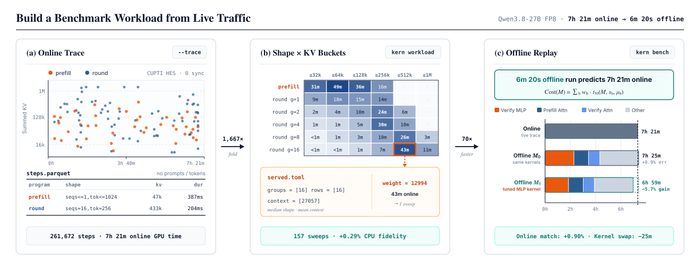

# Trace format

When `kern-serve` runs with `--trace --trace-dir <DIR>` (or a hosted manifest
runs with `KERN_TRACE_DIR=<DIR>`), CUPTI's hardware event system (HES)
timestamps every GPU kernel execution in hardware without inserting
synchronization between launches. Each rank streams those records into pairs of
Apache Parquet files. `kern-serve` also samples the GPU's own performance
counters every 100 µs by default (`--trace-pm-us`, `0` to turn off) into a third
file beside each pair.

[Trace an SGLang server](/guides/trace-sglang) records a hosted manifest step by
step, with a sample trace to query.

Traces record GPU timing and manifest identifiers only. Prompts, token IDs,
completions, request identifiers, and client metadata are never written.

## Layout and rotation

Each rank writes one file pair per UTC quarter hour under Hive-style partition
directories:

```text
<trace-dir>/date=YYYY-MM-DD/rank=<q>/HHMMSS.steps.parquet
<trace-dir>/date=YYYY-MM-DD/rank=<q>/HHMMSS.kernels.parquet
<trace-dir>/date=YYYY-MM-DD/rank=<q>/HHMMSS.counters.parquet
```

`HHMMSS` is the UTC wall-clock time when the pair opened on its first write in
that quarter hour. The counters file, when the rank samples counters, opens and
closes with the pair. While open, the files carry a `.parquet.part` suffix; they
are closed and atomically renamed to `.parquet` at the next quarter-hour
boundary, on `POST /kern/trace/rotate` (served on `--trace-port`), or on clean
process exit. Globbing `*.parquet` reads only finalized files.

A hosted manifest has no trace port: touching `<trace-dir>/rotate` closes its
files instead. SGLang ends its scheduler with a signal, which is no clean
exit, so rotate before stopping the server. Under SGLang's `--dp-size` above
one, every replica is a group of its own and writes this layout under
`<trace-dir>/dp=<i>` (rotated by `<trace-dir>/dp=<i>/rotate`), so `rank` stays
the rank within a replica and `dp` reads as one more partition.

Files use Zstandard compression (level 3), dictionary encoding for strings, and
delta encoding for integer columns.

## Schemas

### `steps.parquet`

One row per manifest program execution issued on that rank:

| Column | Arrow type | Nullable | Meaning |
| --- | --- | --- | --- |
| `seq` | `UInt64` | No | Per-process step counter starting at `1`; resets on server restart |
| `program` | `Utf8` | No | Manifest program name (for example `load`, `prefill`, `decode`, `round`) |
| `shape` | `Utf8` | No | Bucket label: exact `name=value` vars for CUDA graphs (`seqs=1,tokens=16`), or powers of two for eager launches (`seqs<=1,tokens<=64`) |
| `vars` | `Utf8` | No | Exact variable values passed to the program (`seqs=1,tokens=60`) |
| `kv` | `UInt64` | Yes | Exact sum of `seq_len` across active sequences; `null` when none apply |
| `graph` | `Boolean` | No | `true` when launched as a captured CUDA graph |
| `start_ns` | `Int64` | No | Start of the step's first kernel, in Unix nanoseconds |
| `end_ns` | `Int64` | No | End of the step's last kernel, in Unix nanoseconds |

Sample rows from a live `steps.parquet` file:

| `seq` | `program` | `shape` | `vars` | `kv` | `graph` | `start_ns` | `end_ns` |
| ---: | --- | --- | --- | ---: | --- | ---: | ---: |
| `1` | `load` | *(empty)* | *(empty)* | `null` | `false` | `1794373576153298826` | `1794373576154167403` |
| `2` | `prefill` | `seqs<=1,tokens<=64` | `seqs=1,tokens=60` | `60` | `false` | `1794373679657182786` | `1794373679840495810` |
| `3` | `round` | `seqs=1,tokens=16` | `seqs=1,tokens=16` | `76` | `true` | `1794373679864232815` | `1794373679896459210` |
| `250` | `round` | `seqs=4,tokens=64` | `seqs=4,tokens=64` | `190917` | `true` | `1794373944673533923` | `1794373944727533892` |

### `kernels.parquet`

One row per GPU kernel execution on that rank, sorted by `start_ns`:

| Column | Arrow type | Nullable | Meaning |
| --- | --- | --- | --- |
| `seq` | `UInt64` | Yes | `steps.seq` of the owning step; `null` for runtime copies or fills outside a program |
| `start_ns` | `Int64` | No | Kernel start timestamp on the GPU, in Unix nanoseconds |
| `dur_ns` | `Int64` | No | Kernel execution duration on the GPU, in nanoseconds |
| `call` | `Utf8` | Yes | Manifest call `label`, else `<op>#<index>` (`?` if a graph replay did not match capture 1:1; `null` when `seq` is `null`) |
| `op` | `Utf8` | Yes | Manifest operator name (`null` when `seq` is `null`) |
| `kernel` | `Utf8` | No | Underlying CUDA kernel symbol reported by CUPTI |

Sample rows from the matching `kernels.parquet` file (note that a single manifest
`call` such as `l3.attention` may launch multiple CUDA kernels):

| `seq` | `start_ns` | `dur_ns` | `call` | `op` | `kernel` |
| ---: | ---: | ---: | --- | --- | --- |
| `3` | `1794373679864232815` | `4001` | `verify.kv_plan` | `verify_kv_plan` | `attention_plan` |
| `3` | `1794373679869635030` | `151648` | `l0.gate_up` | `verify_linear_34816_5120` | `fp8_block_gemm` |
| `3` | `1794373679870704824` | `1056` | `l3.attention` | `verify_attention_flashinfer` | `quantize_q` |
| `3` | `1794373679870706040` | `8000` | `l3.attention` | `verify_attention_flashinfer` | `prefill_fp8` |
| `null` | `1794373680124006590` | `2592` | `null` | `null` | `flag` |

### `counters.parquet`

One row per counter sample on that rank, back to back in time. Each row is the
whole GPU's counters averaged over the sample's window, read by the GPU itself
with no kernel replayed or inserted:

| Column | Arrow type | Nullable | Meaning |
| --- | --- | --- | --- |
| `start_ns` | `Int64` | No | Window start in Unix nanoseconds, on the same timeline as `kernels.start_ns` |
| `dur_ns` | `Int64` | No | Window length in nanoseconds (the `--trace-pm-us` interval) |
| `sm_mhz` | `UInt16` | No | SM clock in MHz |
| `sm_active_permille` | `UInt16` | No | Permille of elapsed cycles an SM had a warp resident, averaged over SMs |
| `tensor_active_permille` | `UInt16` | No | Permille of elapsed cycles the tensor pipes were busy, averaged over SMs |
| `dram_read_gbs` | `UInt16` | No | DRAM read bandwidth in GB/s |
| `dram_write_gbs` | `UInt16` | No | DRAM write bandwidth in GB/s |

Sampling raises the GPU's power draw by about 35 W at any interval and does not
change kernel durations. The interval cannot go below 50 µs, because the host
spends about 20 µs decoding each sample.

### Joining tables and reading metadata

`seq` is unique only within a single rank process. Always join `steps` and
`kernels` within the same server session and `rank`, never on `seq` alone across
restarts or ranks. Timestamps are CUPTI hardware timestamps shifted by the host
wall-clock offset sampled when the file pair opened, so ranks, files, and logs
share one Unix nanosecond timeline.

Every file also carries Parquet footer key-value metadata:

| Key | Meaning |
| --- | --- |
| `kern.rank` | Rank ordinal that wrote the file |
| `kern.model` | `model` identifier from the manifest |
| `kern.manifest_sha256` | SHA-256 hex digest of the manifest JSON as read |
| `kern.version` | Writer binary version and CUDA build |
| `kern.clock_offset_ns` | Nanoseconds added to CUPTI clock values to obtain Unix time |
| `kern.hes` | `true` when the GPU stamped kernels in hardware; `false` if CUPTI fell back to software timestamps |
| `kern.dropped_records` | Cumulative kernel records lost by CUPTI in this process when the file closed |

## Using a trace

### 1. Build a benchmark workload from live traffic



`kern workload` reads one rank's `steps.parquet` files, groups steps by
`(program, shape, kv bucket)`, and emits a weighted TOML workload that
`kern bench` can price against any candidate manifest for the same model:

```sh
kern workload --manifest manifest.json \
  --trace traces/date=2026-11-11/rank=0 \
  --out served.toml

kern bench demo --workload served.toml --out bench.json
```

Each bucket preserves its step count and mean context, and `kern workload`
reports its bucketing `fidelity` on the CPU before touching a GPU. A full
session of live traffic (~262k steps, 7.3 hours of GPU execution) folds into
~160 scenarios that `kern bench` prices in about six minutes, matching traced
GPU step time within 1% (`+0.29%` bucket fidelity, `+0.90%` replayed GPU cost).

Pass a single rank's directory (`rank=0`) rather than all ranks combined, since
`kern bench` issues each call across every rank of the manifest.

### 2. Break down operator and context cost in SQL

Because directories use `date=` and `rank=` Hive partitions, DuckDB, Polars, and
PyArrow can query a session directly without ETL:

```sql
SELECT
  s.program,
  s.shape,
  k.op,
  count(DISTINCT s.seq) AS steps,
  round(sum(k.dur_ns) / 1e6, 1) AS gpu_ms
FROM read_parquet('traces/date=*/rank=*/*.steps.parquet') s
JOIN read_parquet('traces/date=*/rank=*/*.kernels.parquet') k
  USING (rank, seq)
GROUP BY s.program, s.shape, k.op
ORDER BY gpu_ms DESC
LIMIT 15;
```

Counters join on time instead of `seq`. A step's counters are the samples that
fall inside it:

```sql
SELECT
  s.program,
  count(*) AS samples,
  round(avg(c.sm_active_permille) / 10, 1) AS sm_active_pct,
  round(avg(c.tensor_active_permille) / 10, 1) AS tensor_pct,
  round(avg(c.dram_read_gbs)) AS dram_read_gbs
FROM read_parquet('traces/date=*/rank=*/*.steps.parquet') s
JOIN read_parquet('traces/date=*/rank=*/*.counters.parquet') c
  ON c.rank = s.rank
 AND c.start_ns >= s.start_ns
 AND c.start_ns + c.dur_ns <= s.end_ns
GROUP BY s.program;
```

Grouping `steps` by `kv` buckets (for example `floor(kv / 32768) * 32768`) with
summed `k.dur_ns` per `op` isolates how attention, linear layers, or recurrent
state scale with context length under real traffic.

### 3. Diagnose host gaps and multi-rank skew

- **Inter-step gaps:** `start_ns - lag(end_ns) OVER (PARTITION BY rank ORDER BY seq)`
  in `steps.parquet` measures host scheduling, tokenization, or idle intervals
  between GPU programs.
- **Unclaimed device work:** rows in `kernels.parquet` where `seq IS NULL`
  capture runtime copies, page transfers, or synchronization kernels outside
  manifest programs.
- **Rank imbalance:** comparing compute vs. collective `op` durations across
  `rank=0..N-1` on the shared Unix nanosecond timeline separates a slow compute
  rank from peers waiting in `nccl_*` or peer-buffer reads.
