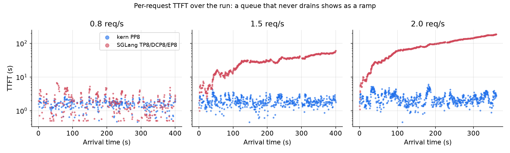
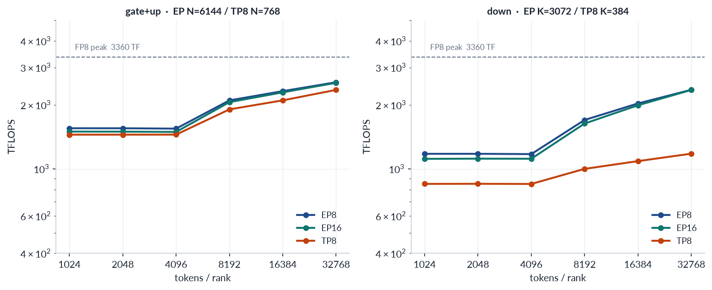
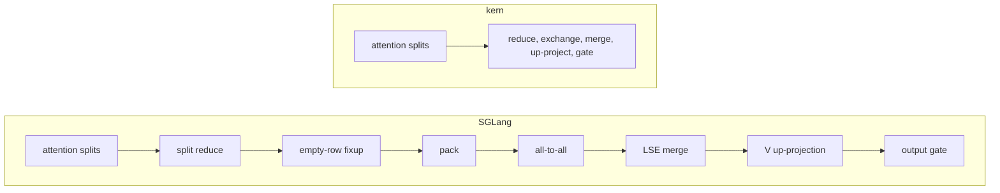

# RFC: bringing kern's Kimi-K3 results back to SGLang and vLLM

Status: draft, 2026-10-13. Prefill and decode each have measurements still
running; the sections say which numbers are final and which are not.

## Summary

kern's agent optimization loop produced a Kimi-K3 prefill layout and a set of
K3 kernels on GB300. This RFC proposes which of them to give back, in two
parts, starting with SGLang. vLLM follows the same plan later.

- **Prefill: propose a design change, with an RFC to SGLang before any code.**
  Running K3 prefill as an 8-stage pipeline, one GPU per group of layers,
  serves about twice the load of SGLang's 8-way tensor parallel prefill on the
  same 8 GPUs. The evidence so far points to the layout as the main source of
  the gain, which a faster kernel inside SGLang's current layout cannot give.
- **Decode: measure first, then send kernels one by one.** We have never
  compared kern's decode with SGLang's on the same shapes, so we do not yet
  know which of our kernels would help. The plan is a head-to-head, a
  per-kernel ledger, and a pull request only for kernels that win inside
  SGLang. The first candidate is a single kernel that replaces the
  post-attention chain of every MLA layer under decode context parallelism.
- **vLLM: to do.** Same two parts once SGLang is under way.

## Terms used below

- **K3**: Kimi-K3, 93 layers (69 linear-attention KDA layers, 24 MLA layers),
  896 routed experts, about 1.5 TB of weights with experts in MXFP4.
- **Hardware**: GB300 GPUs in one NVL72 rack. "8 GPUs" means two 4-GPU nodes
  joined by NVLink.
- **TP8**: every layer's matrices are split across 8 GPUs, which all-reduce
  after attention and after the MoE. The SGLang baseline is TP8 with decode
  context parallelism over 8 GPUs and experts spread over the 8 GPUs (EP8).
- **PP8**: the 93 layers are cut into 8 consecutive groups of about 12, one
  group per GPU, with all 896 experts of those layers on that GPU. A chunk of
  prompt tokens runs through GPU 1, then GPU 2, and so on, while GPU 1 already
  works on the next chunk.
- **Prefill SLA**: time to first token (TTFT) at the 90th percentile under
  5 s. "Capacity" is the highest request rate that still meets it.
- **Cold prefill**: prompts share no prefix, so nothing comes from cache.

## Part 1: prefill

### The result

On cold prompts of 2k to 32k tokens, kern's PP8 handles about twice the
traffic of SGLang TP8 on the same 8 GPUs: 46.2k against 23.7k prompt tokens
per second at full load. Below that point the gap shows up as queueing. At
1.5 requests per second TP8 is already past its throughput limit and its queue
never drains, while PP8 runs at 58% of its own.

Two caveats apply to this result. The SGLang configuration used a MoE backend
that is not SGLang's fastest for this model, and each load point ran once.
Both are being redone (see [What is being measured now](#what-is-being-measured-now)).

### Why the layout matters more than the kernels

TP8 pays three costs that PP8 does not have. Each one is a property of
splitting a layer eight ways, and a better kernel removes none of them.

1. **Communication on every layer.** Each MoE layer needs two all-reduces
   across 8 GPUs. For an 8k-token chunk that is about 0.7 ms per layer, or
   67 ms over the whole model. PP8 sends each chunk's activations once from
   one GPU to the next, and the transfer overlaps the next chunk's compute.
2. **Narrower matrix multiplies.** TP8 cuts each expert's down projection to an
   inner dimension of 384. At that width the GPU reaches about half the
   throughput it gets on the full-width shape, which is what a pipeline stage
   runs (the EP lines below).
3. **Work that does not shrink.** Some operators, such as the MoE router, run in
   full on every GPU under TP8, so 8 GPUs do the same work 8 times.

The kernels explain little of the gap. When both systems run the
same layout, they are close: one pipeline stage takes 156 ms on an 8k chunk
in kern and about the same in SGLang's own pipeline mode, and on a pruned K3
with 4-way tensor parallelism the two are within 15% of each other.

### Where PP8 is worse

- **One long prompt on an idle system.** TP8 puts all 8 GPUs on every chunk
  of the prompt, while PP8 has to fill and drain the pipeline. TP8 measured
  10.5 s on a single 256k prompt; PP8 has not been measured at that length.
- **Failure domain.** If one stage fails, the whole pipeline stops.
- **Fabric.** Each hop moves about 1 GiB per 8k chunk, because K3 carries an
  attention-residual bank alongside the hidden state. On NVLink this hides
  behind compute. Over InfiniBand or RoCE it has not been tested.

### Why SGLang's existing pipeline mode is not the answer

SGLang already has pipeline parallelism, and we measured it on K3. Its
per-stage compute matches kern's, but its GPUs sit idle for 26–66% of the
time while requests are waiting, because every stage re-runs the scheduling
decision and most micro-batches carry a single request. The proposal below
changes that scheduling structure.

### What we would propose to SGLang

At the level of ideas, for discussion before any implementation plan:

1. **A prefill-only pipeline** for disaggregated serving: whole layers per
   GPU, all experts of those layers local, no tensor or expert parallelism
   inside a stage. Decode stays as it is and receives the KV through the
   existing prefill-to-decode transfer.
2. **One scheduler, at the head of the pipeline.** It batches prompts, packs
   several short prompts into one chunk, and owns the prefix cache and the
   KDA state checkpoints. The other stages only execute what arrives, so a
   stage is a function of its input and never decides anything.
3. **Stage-to-stage transfer outside the model code.** A stage reads its input
   buffer and writes its output buffer; the runtime moves the data over
   NVLink and overlaps it with compute.

kern's version of this design is described in [serve.md](serve.md) (the
pipeline section) and [protocol.md](protocol.md). The K3 stage manifests and
kernels are public in
[kern-k3-pp-prefill](https://github.com/pegainfer-project/kern-k3-pp-prefill).

Open questions for the SGLang community: whether this belongs in the
disaggregated prefill server or in the general pipeline mode, how it fits with
the radix cache and HiCache when the cache lives only at the head, and where
the KDA state slots live.

## Part 2: decode

### The result so far

There is no same-shape comparison of kern's decode and SGLang's decode yet,
so we cannot say which side is faster or by how much. The numbers we have
differ in KV precision (SGLang stores the MLA cache in FP8, kern in BF16),
all-reduce backend, timing method, and input text. The plan below exists to
fix that before anything is proposed.

### Plan

1. **Head-to-head on the same shapes.** Same 8 GPUs, same weights, both with
   CUDA graphs and without speculative decoding. Batch of 8 to 64 sequences,
   context of 64k, 128k and 219k tokens, real text. SGLang runs with its fused
   all-reduce both on and off. Both sides are timed per step on the GPU.
2. **A per-kernel ledger.** Profile both at the same shapes and sort each
   layer's time into MLA attention, KDA, MoE GEMMs, routing, decode context
   exchange, all-reduce, dense GEMMs, and gaps between kernels. The categories
   where kern is clearly faster become pull-request candidates; the ones where
   SGLang is faster tell us what to fix in kern.
3. **Port the winners into SGLang and measure there.** A pull request goes up
   only when the kernel speeds up SGLang's own decode step.

### Candidates and what we know about each

The step-time gains below were measured inside kern, against kern's earlier
implementation of the same operation. None has been measured against SGLang.

| candidate | gain inside kern | status in SGLang |
|---|---|---|
| Fused decode context exchange (below) | −4.2% step time | runs as a chain of separate kernels |
| MoE front: two-level top-k, routing table, quantization and shared-expert activation in one kernel | −3.6%, and −1.3% more from a faster top-k | partly fused already |
| Fused all-reduce + residual + norm | slower than FlashInfer's MNNVL all-reduce by 1.2–1.6× | not a candidate |

SGLang is ahead of kern on FP8 KV for MLA decode, which halves the bytes read
at long context, and on the tile choice of one MoE GEMM.

### The first candidate: one kernel after MLA attention

With decode context parallelism, each GPU holds a slice of every sequence's KV
and computes partial attention for all heads. The partials then have to be
merged across GPUs before the output projection. In SGLang that takes a chain
of kernels per MLA layer; kern does all of it in one.

Across 24 MLA layers that removes more than a hundred kernel launches per
decode step. kern's kernel reads the attention kernel's split partials
directly. That attention kernel is FlashInfer's CuTe DSL MLA decode, which
SGLang also runs (kern uses its BF16-cache build, SGLang the FP8 one). How
much work the integration takes is being studied now.

## Part 3: vLLM

To do. What we already know: vLLM's FlashInfer all-reduce is faster than
kern's, so that is not a candidate; vLLM already shards the MoE latent
up-projection by row, which SGLang does not. The prefill layout argument
applies to vLLM unchanged.

## What is being measured now

| measurement | answers |
|---|---|
| SGLang TP8 with its strongest prefill configuration, then TTFT at one request at a time from 1k to 256k tokens, kern PP8 on the same prompts | how much of the prefill gap survives a fair baseline, and where TP8 wins |
| Capacity at TTFT p90 under 5 s for both, random 2k–32k prompts, three runs each, same nodes | the headline prefill number |
| Profile of SGLang TP8 prefill split into compute, communication and replicated work | how much of the gap each of the three costs explains |
| The decode head-to-head and ledger above | which decode kernels to send |
| Integration study for the fused decode context exchange | the cost of the first decode pull request |

## Appendix A: prefill measurement setup (2026-10-08)

- Prompts: random token ids, 2k–32k uniform (mean 17.9k), `max_tokens=1`, no
  shared prefixes, the same seed for both servers.
- Capacity: 16 concurrent requests, unlimited rate, 200 prompts. Load:
  Poisson arrivals at 0.8, 1.5 and 2.0 requests per second.
- kern PP8: 8 stages over two 4-GPU nodes, 8192-token chunks, up to 16
  prompts in flight.
- SGLang: nightly `cu13-20261004-295a53c9`, TP8 with decode context
  parallelism 8 and EP8, 16k chunks, FP8 KV cache, `flashinfer_mxfp4` MoE
  runner without all-to-all, radix cache off, prefill CUDA graph off.

| run | requests/s achieved | prompt tokens/s | TTFT p50 | TTFT p90 | TTFT p99 |
|---|---|---|---|---|---|
| PP8, full load | 2.57 | 46.2k | 6.19 s | 7.45 s | 9.13 s |
| TP8, full load | 1.32 | 23.7k | 11.7 s | 15.2 s | 17.3 s |
| PP8, 0.8/s | 0.80 | 13.8k | 1.60 s | 2.15 s | 2.61 s |
| TP8, 0.8/s | 0.79 | 13.8k | 1.77 s | 3.82 s | 5.61 s |
| PP8, 1.5/s | 1.49 | 26.9k | 1.84 s | 2.77 s | 3.43 s |
| TP8, 1.5/s | 1.30 | 23.5k | 29.5 s | 49.1 s | 54.3 s |
| PP8, 2.0/s | 1.98 | 35.7k | 2.27 s | 3.66 s | 4.91 s |
| TP8, 2.0/s | 1.32 | 23.7k | 87.8 s | 165 s | 182 s |

The full-load rows keep 16 requests in flight, which pushes both systems past
the SLA, so they give peak throughput. Capacity under the SLA is being
measured now. The two 0.8/s runs used different nodes.

## Appendix B: sources of the prefill mechanism numbers

- Communication and GEMM widths: per-layer microbenchmarks of K3's shapes on
  GB300, all-reduce across 8 GPUs in one NVL72 rack, 2026-08-17.
- Same-layout kernel comparison: one PP8 stage on an 8k chunk measured in
  kern (2026-10-07) and the per-stage forward time logged by SGLang's own
  pipeline mode (2026-10-06); pruned K3 at TP4, kern 598 ms against SGLang
  683 ms on a 16k prompt (2026-09-22).
- SGLang pipeline mode idle time: per-rank timelines from SGLang PP8 on K3
  under synthetic and agent traffic, 2026-10-06.
- TP8 at 256k: SGLang TP8 with the MegaMoE backend, one request, 2026-09-24.
